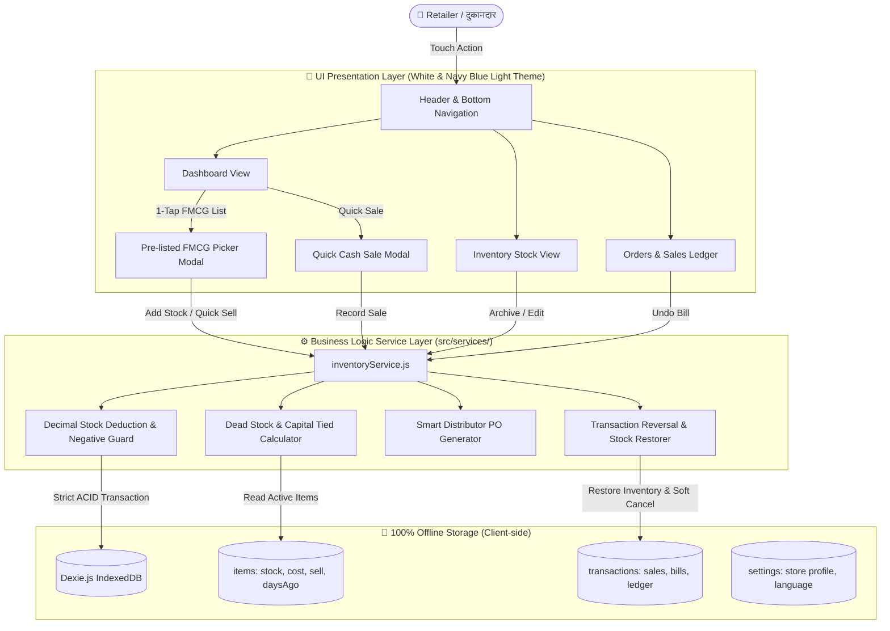
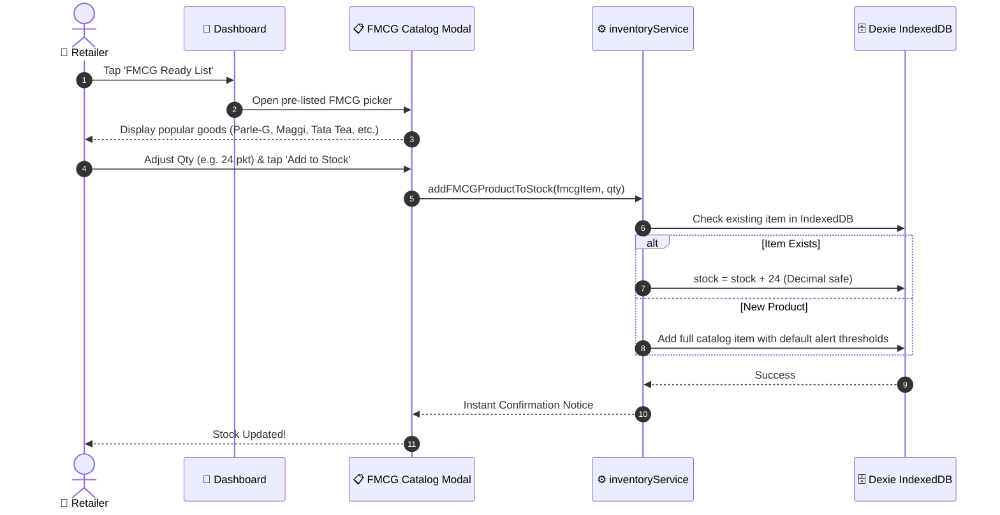
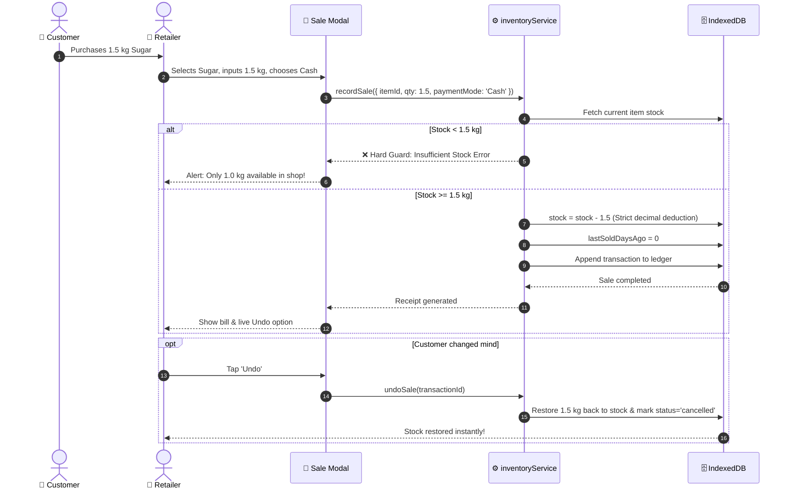
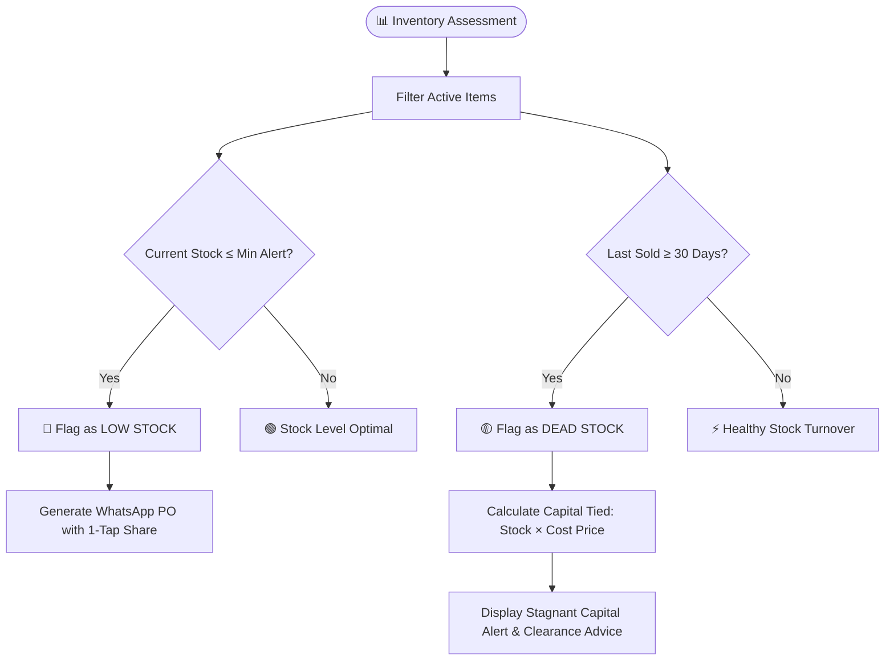

# 🛒 Sauda Samrat (सौदा सम्राट)
> **दुकानदार का सच्चा ऑफलाइन साथी (Retailer’s Reliable Offline Companion)**
> An offline-first, multilingual, touch-first inventory & point-of-sale Progressive Web App (PWA) tailored specifically for small Indian retailers (Kirana, chemist, stationery, hardware).

[](https://react.dev/)
[](https://vitejs.dev/)
[](https://tailwindcss.com/)
[](https://dexie.com/)
[](https://web.dev/progressive-web-apps/)
[](https://harsh349-bot.github.io/Sauda-samrat/)
[](LICENSE)

🌐 **Live Demo URL:** [https://harsh349-bot.github.io/Sauda-samrat/](https://harsh349-bot.github.io/Sauda-samrat/)

---

## 🌟 Key Highlights & Philosophy

- 🌐 **100% Offline-First Architecture**: Powered by client-side **Dexie.js (IndexedDB)**. Works seamlessly inside basements, rural lanes, or during internet disruptions with zero backend dependencies.
- 🇮🇳 **Multilingual & Everyday Hindi**: One-tap toggle between **English** and **everyday Hindi (हिंदी)**. Strictly eliminates confusing corporate jargon (e.g., no "SKU", instead using *सामान का नाम*, *स्टॉक*, *बिक्री पर्ची*).
- 🏷️ **Icons + Text Everywhere**: Every label and actionable element is paired with an intuitive **Lucide React icon** alongside descriptive text — never relying on color alone.
- 📦 **Pre-Listed Popular Indian FMCG Catalog**: Eliminates tedious manual typing with pre-configured high-demand Indian FMCG items (Parle-G, Maggi, Tata Tea, Dettol, Fortune Oil, Colgate, etc.) ready to add to stock or sell with a single tap.
- ⚠️ **Smart Stock Tracking**: 
  - **Low Stock Alerts**: Real-time warnings when items drop below safety thresholds with 1-tap WhatsApp distributor purchase orders.
  - **Dead Stock Tracker**: Identifies stagnant products (30+ days without sales) and calculates locked/tied working capital (e.g. *₹240 locked*).
- ⚖️ **Decimal Quantities & Hard Negative Guards**: Fully supports fractional metrics (`0.5 kg`, `1.25 L`), strictly enforces unit consistency, and bars negative stock in the service layer.
- 🛡️ **Soft Deletion & Instant Undo**: Zero accidental record destruction — entries use status flags (`status: 'archived'`), and sales feature an instant **Undo** that restores subtracted inventory.
- 📱 **Mobile-First & Touch Ergonomics**: Minimum touch targets of **48×48px** with a crisp White and Navy Blue light theme.

---

## 🛠️ Languages & Technologies Used

| Technology / Tool | Icon & Badge | Purpose & Role |
|---|:---:|---|
| **JavaScript (ES6+)** | 🟨 `JS` | Core application logic, functional state, and async IndexedDB transactions |
| **React 19** | ⚛️ `React` | Component-based responsive UI, modal orchestration, and reactive views |
| **Tailwind CSS v4** | 🎨 `Tailwind` | Mobile-first White and Navy Blue theme, touch target ergonomics (`≥48px`) |
| **Dexie.js** | 🗄️ `IndexedDB` | Client-side transactional offline database storing products, orders, and settings |
| **vite-plugin-pwa** | 📲 `PWA` | Service Worker caching, app manifest generation, and installable offline support |
| **Lucide React** | ✨ `Icons` | Interactive icon set guaranteeing icon + text pairing across all interfaces |

---

## 📐 System Architecture & Data Flow



---

## 🔄 User Workflows

### 1. Inflow: Adding from Pre-Listed FMCG Catalog


---

### 2. Outflow: Quick Sale with Negative Stock Guard & Undo


---

### 3. Inventory Monitoring: Low Stock & Dead Stock Detection


---

## 📁 Repository Directory Structure

```
Sauda-samrat/
├── public/                 # Static assets, web manifest, PWA icons
├── src/
│   ├── components/         # Reusable presentation components
│   │   ├── AddEditItemModal.jsx   # Custom product entry with alert thresholds
│   │   ├── FMCGCatalogModal.jsx   # Pre-listed Indian FMCG stock & sales picker
│   │   ├── Navigation.jsx         # Header (store info + language) & BottomNav
│   │   └── QuickSaleModal.jsx     # Decimal quantity sale entry with payments
│   ├── db/
│   │   └── index.js        # Dexie.js schema, tables, and seed dataset
│   ├── i18n/
│   │   └── index.js        # Multilingual dictionary (English & Hindi)
│   ├── pages/
│   │   ├── DashboardPage.jsx      # KPI metrics, dead stock widget, quick actions
│   │   ├── InventoryPage.jsx      # Stock catalog, Low/Dead stock filters, search
│   │   ├── OrdersPage.jsx         # Sales receipts, Khata status, WhatsApp share
│   │   └── SettingsPage.jsx       # Store info, JSON backup, CSV export, reset
│   ├── services/
│   │   └── inventoryService.js    # Strict business logic: stock math, negative guards
│   ├── App.jsx             # Root orchestrator & tab controller
│   ├── index.css           # Tailwind v4 theme, mobile utilities, touch targets
│   └── main.jsx            # Application mount point
├── index.html              # HTML shell with mobile viewport & theme-color
├── package.json            # Scripts & project dependencies
├── vite.config.js          # Vite config with React, Tailwind v4, & VitePWA
└── README.md               # Detailed documentation
```

---

## 🚀 Getting Started

### Prerequisites
- [Node.js](https://nodejs.org/) (v18.0.0 or higher)
- [npm](https://www.npmjs.com/) (v9.0.0 or higher)

### Installation & Local Run

1. **Clone the repository:**
   ```bash
   git clone https://github.com/HARSH349-bot/Sauda-samrat.git
   cd Sauda-samrat
   ```

2. **Install dependencies:**
   ```bash
   npm install
   ```

3. **Start the local development server:**
   ```bash
   npm run dev
   ```
   Open **[http://localhost:5173](http://localhost:5173)** in your browser. (Press `F12` and switch to Mobile Device View for optimal touch testing).

4. **Build production bundle:**
   ```bash
   npm run build
   ```
   *Output is generated inside `dist/` with auto-registered service workers for offline caching.*

---

## 📜 Retailer Rules & Design Principles

1. **Mobile First & Touch Targets**: All interactive elements strictly maintain a minimum touch bounding box of `48×48px`.
2. **Icon + Text Pairing**: Meanings are never represented by color alone; every action features a distinct visual icon and readable text.
3. **Strict Business Logic Isolation**: UI components are pure presentation; stock deductions, decimals, and validations reside strictly in `src/services/inventoryService.js`.
4. **Data Safety**: Hard deletes are forbidden. Soft archiving and full JSON backup/export ensures zero data loss.
